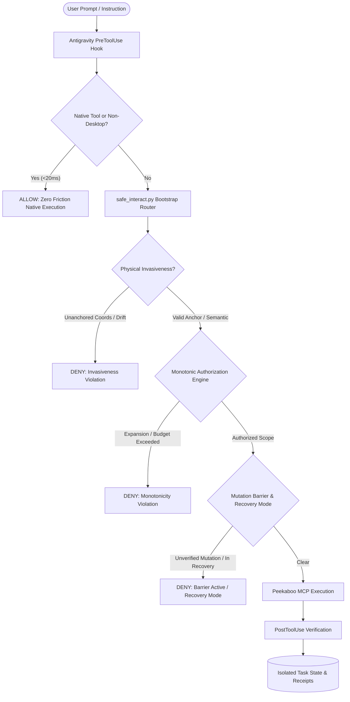

# Finest Computer Use Safety (v1.1.1)

[](https://github.com/enriquemdev/finest-computer-use/actions/workflows/ci.yml)
[](https://github.com/enriquemdev/finest-computer-use/releases/tag/v1.1.1)
[](https://www.python.org/)
[-orange.svg)](https://support.apple.com/macos)
[](https://opensource.org/licenses/MIT)
[](tests/)
[](tests/test_fresh_install.py)
[](scripts/)

> **Hardened, non-invasive macOS Computer Use Safety Architecture for Agentic AI.**
> Enforces PreToolUse interception, monotonic intent authorization, side-effect budgets, mutation barriers, task-level state isolation, and fail-safe degraded modes.

---

## 1. Overview & Motivation

When AI agents operate graphical user interfaces (GUI) on macOS via desktop automation tools (such as Peekaboo MCP), subtle UI ambiguities can cause severe divergence between user intent and agent actions.

A classic real-world failure mode:
> **Authorized Intent:** Send a short text message in a chat application.  
> **Agent Action:** Clicks an ambiguous icon adjacent to the input field (`ChatBar_VoiceMessageButton` instead of Send).  
> **Unintended External Effect:** Begins audio recording, and subsequent actions send an unauthorized voice message.

**Finest Computer Use** eliminates this failure class by operating on a foundational principle:

### **AUTHORIZED EFFECTS ONLY**

The agent is permitted to execute whatever low-risk, observational, or preparatory actions are required to fulfill a user goal, but it is strictly barred from executing any external, irreversible, or adjacent side effect that was not monotonically authorized by the user.

---

## 2. Core Architectural Pillars



### 1. Non-Invasive First Policy (Tiers 0–4)
Assumes the user is actively using the Mac concurrently at all times:
- **Tier 0 (Structured Interfaces):** CLI, filesystem, domain-specific APIs preferred before touching GUI.
- **Tier 1 (Background Semantic - Default):** macOS Accessibility tree inspection (`see`, `inspect_ui`), `set_value`, `menu`, `window` without cursor movement or window activation.
- **Tier 2 (Background Coordinate):** Strictly anchored to exact window, application, and fresh reference snapshot. Zero unanchored global coordinate clicks (`click --at X,Y` without target is blocked).
- **Tier 3 (Foreground Semantic):** Fresh snapshot, minimal target app focus, execute single action, verify, release foreground.
- **Tier 4 (Foreground Coordinate - Last Resort):** Re-observe immediately before click, single action, immediate verification.

### 2. The 6-Level Effect Taxonomy
Every GUI action, tool call, and terminal command is classified into a strict effect level:

| Level | Classification | Examples | Guardrail |
| :--- | :--- | :--- | :--- |
| **0** | Pure Observation | `see`, `inspect_ui`, `browser(snapshot)`, `view_file` | Freely permitted, zero mutation |
| **1** | Transient Local Focus | `window`, `space`, `scroll`, `hover` | Permitted under target anchor |
| **2** | Reversible In-Progress Input | `type`, `set_value` into active input field | Allowed within authorized field |
| **3** | Non-Destructive Persistent Mutation | Creating local scratch file, drafting email | Monitored, local scope |
| **4** | External / Irreversible Action | `click(send)`, audio recording, git push, email send | Strict Contract + Budget + Receipts |
| **5** | High-Impact / Destructive Action | `click(delete)`, purchase, system configuration | Explicit user confirmation required |

### 3. PreToolUse Hard Enforcement
- Registered in `~/.gemini/config/hooks.json` under `PreToolUse`.
- Intercepts **every tool call before dispatch**.
- Built-in **fast-path router (< 20ms)** allows developer CLI tools (`git`, `pytest`, `npm`, `view_file`, `replace_file_content`) to execute with zero overhead and zero friction.

### 4. Monotonic Authorization Engine
- **Strict Provenance Tracking:** Distinguishes whether a contract modification originated from the `user` or the `agent`.
- **Scope Narrowing Allowed:** The agent may narrow target scope (e.g. restrict to `chat/thread_42`).
- **Expansion Forbidden:** The agent cannot unilaterally introduce new Level 4/5 effects, increase effect budgets, or broaden target scopes without explicit user instruction.

### 5. Mutation Barriers & Target-Bound Verification
- Enforces an invariant: `OBSERVE -> MUTATE -> VERIFY`.
- Consecutive unverified mutations are blocked by the firewall.
- Only a **target-bound observation** (inspecting the UI component that was mutated) clears the barrier. Observations of unrelated apps do not clear the mutation barrier.

### 6. True Task-Level State Isolation
- State is keyed by composite `(conversation_id, task_id)`.
- Multi-task execution in the same session does not cross-contaminate contracts, budgets, commit receipts, or recovery mode status.
- Prevents cross-task receipt theft and unauthorized state inheritance.

### 7. Degraded Mode: Anti-Brick + Anti-Fail-Open
- If the advanced firewall service experiences an exception or syntax fault, the system enters **Fail-Safe Degraded Mode**.
- **Anti-Brick:** Benign developer tools (`git`, `ls`, file edits) remain fully accessible so developers can inspect and fix the environment.
- **Anti-Fail-Open:** High-impact desktop and browser mutations (`click`, `submit`, `purchase`, `upload_file`) are strictly blocked.
- Browser actions are granularly classified: read-only inspection (`snapshot`, `console`, `network`) and reversible navigation (`navigate`, `new_page`) remain available, while mutation actions fail-closed.

---

## 3. Repository Structure

```
finest-computer-use/
├── .github/workflows/
│   └── ci.yml                      # Portable multi-OS CI regression workflow
├── docs/                           # Exhaustive technical documentation
│   ├── architecture.md             # Complete system architecture and call graphs
│   ├── threat-model.md             # Threat vectors, mitigations, and attack models
│   ├── effect-firewall.md          # Firewall internals, state machines, receipts
│   ├── non-invasive-computer-use.md# Tier 0-4 execution policy & background rules
│   ├── degraded-mode.md            # Anti-brick and anti-fail-open failure semantics
│   ├── installation.md             # Installation, upgrade, and rollback manual
│   ├── troubleshooting.md          # Concrete diagnostics for 7 major failure modes
│   ├── fresh-mac-acceptance.md     # Clean-machine acceptance test harness & checklist
│   ├── recovery.md                 # UI desynchronization & recovery mode protocol
│   ├── testing.md                  # Test suites, mocks, and E2E verification
│   └── limitations.md              # Boundary conditions and platform scope
├── hooks/
│   ├── hooks.json                  # Standalone Antigravity hooks configuration template
│   └── plugin-hooks.json           # Antigravity plugin-compatible hooks template
├── policy/
│   ├── GEMINI.md                   # Managed system instructions block
│   └── SKILL.md                    # Antigravity computer-use skill definition
├── scripts/
│   ├── bootstrap.py                # One-command clean-machine onboarding orchestrator
│   ├── doctor.py                   # Multi-tier environment and diagnostic inspector
│   ├── smoke_test.py               # Safe, non-invasive runtime smoke verification
│   ├── fresh_mac_acceptance.py     # Clean-Mac acceptance test & audit evidence collector
│   ├── install.py                  # Idempotent installer with atomic backup & rollback
│   ├── uninstall.py                # Safe uninstaller restoring previous state
│   ├── deploy_firewall.py          # Staging deployer with py_compile & LKG rollback
│   ├── backup_current.py           # Snapshot utility for active configurations
│   └── firewall_healthcheck.py     # 30-point standalone healthcheck verification
├── src/finest_computer_use/
│   ├── __init__.py                 # Package root
│   ├── safe_interact.py            # PreToolUse / PostToolUse hook router
│   ├── effect_firewall.py          # Contracts, budgets, barriers, task isolation
│   └── effect_taxonomy.py          # 6-level taxonomy & semantic classification
├── tests/
│   ├── fixtures/                   # Test fixtures and incident scenarios
│   ├── mock_ui/                    # Standalone HTML mock UI testbed
│   │   └── mock_ui.html
│   ├── test_fresh_install.py       # Clean-machine onboarding lifecycle test suite (31 tests)
│   └── run_firewall_regression.py  # 35-test comprehensive regression runner
├── CHANGELOG.md                    # Architecture release notes (v1.1.1)
├── CONTRIBUTING.md                 # Contribution guidelines and staging requirements
├── LICENSE                         # MIT License
├── MANIFEST.json                   # Cryptographic manifest of release artifacts
├── pyproject.toml                  # Python package metadata (Python 3.9+)
├── README.md                       # This documentation
├── SECURITY.md                     # Security policy, vulnerability disclosures
└── VERSION                         # 1.1.1
```

---

## 4. Quickstart

### Prerequisites
- **macOS 15.0+ (Sequoia)** required for live desktop GUI automation with Peekaboo 4.3+ (or Linux for portable CI/headless tests)
- **Python 3.9+** (uses standard library only)
- **Antigravity 2.0+**
- **Peekaboo CLI**: `brew install steipete/tap/peekaboo`

### 1. One-Command Setup (Recommended)
Clone the repository and run the onboarding bootstrap orchestrator:

```bash
git clone https://github.com/enriquemdev/finest-computer-use.git
cd finest-computer-use

# One-command onboarding (detects Antigravity, registers Peekaboo MCP, installs hooks & policies, runs doctor)
python3 scripts/bootstrap.py
```

To test without touching any files:
```bash
python3 scripts/bootstrap.py --dry-run
```

### 2. Environment Diagnostics
Check system prerequisites, TCC permissions, MCP registration, and runtime integrity at any time:

```bash
python3 scripts/doctor.py
```

### 3. Safe Runtime Smoke Test
Verify that background semantic inspection works and unanchored coordinate clicks are actively blocked:

```bash
python3 scripts/smoke_test.py
```

### 4. Advanced Installation Options
If you prefer fine-grained step-by-step control:
- Run installer directly: `python3 scripts/install.py`
- Uninstall and restore prior state: `python3 scripts/uninstall.py`
- Run 30-point firewall healthcheck: `python3 scripts/firewall_healthcheck.py`
- Run 35-test regression suite: `python3 tests/run_firewall_regression.py`
- Run 31-test clean-machine lifecycle suite: `python3 tests/test_fresh_install.py`

---

## 5. Verification & Testing

The test suite covers 35 discrete scenarios verifying all layers of the architecture:

```bash
python3 tests/run_firewall_regression.py
```

```
=====================================================================
STARTING FULL COMPUTER USE SAFETY v1 REGRESSION SUITE (35 TESTS)
=====================================================================
--- Test A: Semantic Mismatch (send_text vs voice_message) --- PASS
--- Test B: Unauthorized Adjacent Effect (submit_text vs upload_file) --- PASS
--- Test C: Side-Effect Budget (Limit = 1) --- PASS
--- Test D: Mutation Barrier (Observe -> Mutate -> Verify) --- PASS
--- Test E: Unexpected State Transition (Recovery Mode Gating) --- PASS
--- Test F: Recovery Mode Operations --- PASS
--- Test G: Unknown High-Impact Control (Fail-Closed) --- PASS
--- Test H: Unknown Low-Risk Control (Permissive Exploration) --- PASS
--- Test I: Shell / AppleScript Bypass Detection --- PASS
--- Test J: Browser / DOM Effect Classification --- PASS
--- WhatsApp Incident Fixture --- PASS
--- Test L: E2E Natural Language Task Effect Contract --- PASS
--- Test M: True E2E Mock UI Semantic Mismatch --- PASS
--- Test N: Mutation Barrier & Target-Bound Observation Verification --- PASS
--- Test O: Unexpected State Conflict & Safe Baseline Recovery --- PASS
--- Test P: Fail-Safe Degraded Mode (Anti-Brick & Anti-Fail-Open) --- PASS
--- Test Q: Multi-Session Concurrency & State Isolation --- PASS
--- Test R: Daily Developer Autonomy & Friction Verification --- PASS
--- Test S: Monotonic Authorization — Unauthorized Contract Expansion --- PASS
--- Test T: Monotonic Authorization — Effect Budget Expansion Blocked --- PASS
--- Test U: Monotonic Authorization — Target Broadening Blocked --- PASS
--- Test V: Monotonic Authorization — Target Narrowing Allowed --- PASS
--- Test W: Monotonic Authorization — New User Authorization --- PASS
--- Test X: True Task-Level Isolation (Same Conversation) --- PASS
--- Test Y: Cross-Task Receipt Theft Blocked --- PASS
--- Test Z: Cross-Task Verification Leak Blocked --- PASS
--- Test AA: Cross-Task Recovery Leak Blocked --- PASS
--- Test AB: Degraded Browser Read Inspection Allowed --- PASS
--- Test AC: Degraded Browser Reversible Navigation Allowed --- PASS
--- Test AD: Degraded Browser Send Mutation Denied --- PASS
--- Test AE: Degraded Browser Purchase/Delete Denied --- PASS
--- Test AF: Degraded Browser Unknown Mutation Denied (Fail-Closed) --- PASS
--- True E2E Test 1: Full Monotonic Authorization Pipeline --- PASS
--- True E2E Test 2: Full Same-Conversation Multi-Task Execution --- PASS
--- True E2E Test 3: Full Degraded Browser Action-Level Classification --- PASS
=====================================================================
ALL 35 REGRESSION TESTS PASSED WITH 100% SUCCESS (TESTS A-AF + E2E 1-3)
=====================================================================
```

### Clean-Machine Onboarding & Lifecycle Test Suite
Validates simulated virgin installations, dry-run zero-mutation, idempotence, user config preservation, clean uninstallation, and staged rollback:

```bash
python3 tests/test_fresh_install.py
```

```
=================================================================
FRESH INSTALL HARNESS SUMMARY: 31 PASSED, 0 FAILED
=================================================================
```

### Acceptance Audit & Certification
For comprehensive acceptance certification on any target Mac:

```bash
python3 scripts/fresh_mac_acceptance.py
```

---

## 6. License

This project is licensed under the terms of the [MIT License](LICENSE).
